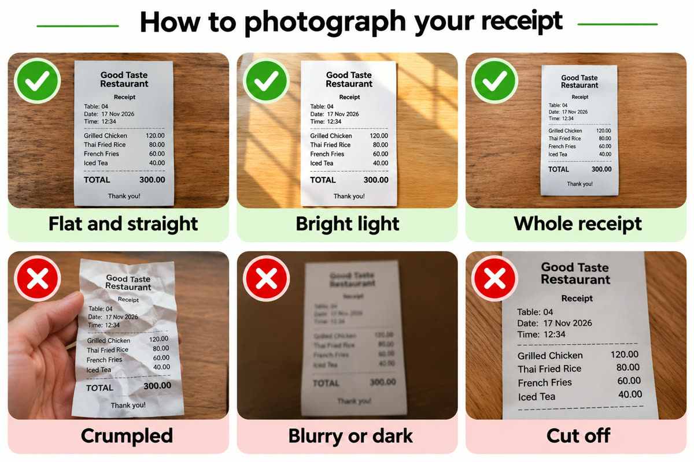

# Split Bill

Snap a photo of a restaurant receipt, tap who ate what, and get how much each friend owes the person who paid.

Built for the usual situation in Thailand: one friend pays for the whole table, then has to work out and chase everyone's share by hand.

    

**Live:** https://split-bill-pvv2.onrender.com
(free instance: the first visit after a quiet spell takes about a minute to wake up)

## Features

- **Read the receipt from a photo or a screenshot.** Items, quantities, prices, service charge, VAT, discount and the printed total.
- **Check against the printed total.** The page says whether the items add up to the receipt, and every name and price can be edited.
- **Tap who ate what.** Shared dishes are split evenly between the people tapped.
- **Fair extras.** Service charge, VAT and discounts are shared in proportion to what each person ate.
- **Exact to the satang.** The shares always add up to the bill, including the receipt's own rounding.
- **Copy the summary.** One button copies a plain-text list of who owes how much, ready to paste into LINE, Messenger, Discord or any chat.

## How it reads a receipt

The phone always tries first, so AI is only called when it has to be.

Every image is cleaned up and read by Tesseract.js on the phone first. Gemini reads it only when the phone's items do not add up to the printed total.

A phone result is trusted only when it adds up. For a screenshot that does not add up, the phone result is kept as a fallback in case AI is down. For a camera photo it is dropped, because a half-read photo is mostly noise.

Screenshots are detected by file type (PNG) or by the image matching the phone's screen size exactly. If Gemini is busy, the page waits a moment and retries once, then offers a button to try again.

### Cleaning up a photo before OCR

Tesseract expects a flat page of text. A phone photo has a table, a hand and a tilted receipt; a screenshot has a status bar and app buttons. `receipt-prep.js` fixes that on the phone, in plain JavaScript:

1. Find the receipt: the largest region that is bright and colourless (white paper, not skin or wood).
2. Cut it out along its own axes, blank everything around it, and scale it to a fixed width.
3. Straighten the text: try angles up to ±20° and keep the one where the text lines line up best.
4. Black and white with an adaptive threshold, so shadows across the paper do not hide text.

This takes under a second.

When phone OCR gets the prices right but garbles Thai names, a button lets the user ask AI to re-read the same image.

### Tested on real receipts

Six hand-held photos of paper receipts from Thai restaurants and shops:

| Reader | Text quality | Items add up to the total |
|---|---|---|
| Tesseract.js, raw photo | noise | 0 / 6 |
| Tesseract.js, cleaned-up photo | most item lines readable on 2 receipts | 0 / 6 |
| Gemini | correct | 6 / 6 |

Cleanup turns noise into mostly readable text, but one wrong digit (415 read as 416) is enough to fail the check, so on these photos Gemini still did the final read. Clear, flat photos are the ones the phone can finish on its own.

Screenshots gain too. A 7-Eleven app screenshot (12 items, a discount, total 471) failed the check when read as is, because the status bar and app header were read as items. After cleanup it added up, with no AI call.

### Why OCR runs in the browser

The first version ran Tesseract on the server. On Render's free instance a single photo took 2 to 4 minutes, and the leftover OCR work starved the Gemini call. A phone reads the same screenshot in a few seconds.

| Receipt | Server OCR (Render free) | Browser OCR |
|---|---|---|
| 7-Eleven app slip | 202 s | 4 s (no AI needed) |
| KFC paper receipt, hand-held photo | 252 s | 16 s (OCR fails, Gemini reads it) |

## Taking a good photo



The same guide is in the app under the photo buttons.

## How the split is calculated

All money is handled in satang (integers), never floating point.

1. Each dish is divided evenly between the people who ate it. When it does not divide evenly, the leftover satang go to the people with the largest remainders (the largest-remainder method).
2. The extras (service charge + VAT − discount) are divided in proportion to each person's food, again with the largest-remainder method.
3. When the items match the printed total, the difference (for example "Rounding 0.91") is treated as part of the extras, so the result matches the receipt exactly.

Example: A has fried rice 120, B has iced tea 90, all three share a hotpot 300. Service 10% and VAT 7% add 90.27.

| Person | Food | Share of extras | Pays |
|---|---|---|---|
| A | 220.00 | 38.94 | 258.94 |
| B | 190.00 | 33.63 | 223.63 |
| C | 100.00 | 17.70 | 117.70 |
| **Total** | 510.00 | 90.27 | **600.27** |

The tests check this bill by hand, and 5,000 random bills for two rules: the shares always add up to the bill, and nobody is off from their exact share by more than a few satang.

## Tech

- Java 21, Spring Boot 4
- Tesseract.js in the browser; Tesseract via Tess4J on the server when language data is present (local runs)
- Gemini API, trying several models when one is busy
- Plain HTML/CSS/JS front end, no framework
- Docker, deployed on Render

| File | What it does |
|---|---|
| `static/index.html` | The whole front end: photo routing, item editor, results, copy summary |
| `static/js/receipt-prep.js` | Photo cleanup before phone OCR: find, cut out, straighten and binarize the receipt |
| `static/js/receipt-parser.js` | Raw OCR text to items and totals in the browser |
| `ReceiptParser.java` | Same parser on the server; both tolerate common Tesseract mistakes on Thai text |
| `SplitCalculator.java` | Splits items and extras between people, exact to the satang |
| `OcrReader.java` / `ReceiptReader.java` | Server-side Tesseract and Gemini readers |
| `ApiController.java` | `/api/scan`, `/api/split` |

## Run locally

Requires JDK 21+.

```sh
export GEMINI_API_KEY=your-key   # needed for camera photos; screenshots work without it
./mvnw spring-boot:run
```

Open http://localhost:8080.

Tests:

```sh
./mvnw test                  # Java: parser and split math
node --test src/test/js      # JavaScript parser and photo cleanup
```

Optional: to let the server run OCR too (for API clients that are not the web page), put Tesseract language data in `tessdata/`:

```sh
mkdir tessdata
curl -L -o tessdata/tha.traineddata https://github.com/tesseract-ocr/tessdata_best/raw/main/tha.traineddata
curl -L -o tessdata/eng.traineddata https://github.com/tesseract-ocr/tessdata_best/raw/main/eng.traineddata
```

> Maven fails to start if the project path contains non-ASCII characters (for example Thai folder names). Keep the project in an ASCII path.

## Deploy

The repo includes a `Dockerfile` and `render.yaml`. On Render, create a new Blueprint from this repo and set `GEMINI_API_KEY` in the dashboard.

## Limitations

- Camera photos depend on Gemini's free tier. When every model is busy or out of quota, the page asks the user to try again later.
- Tesseract reads prices reliably on screenshots, but Thai item names often come out with wrong vowels or tone marks. Names can be edited, or re-read with AI.
- When a dish does not divide evenly, the leftover satang always land on the same people, so one friend may pay a few satang more.
- The first scan on a phone downloads the Thai and English OCR data (a few MB); later scans use the browser cache.

BY Thinnaphat.
